# mfego ↔ bdToolbox: multi-fidelity foil optimization

`pipelines/bdtoolbox_foil` connects the mfego multi-fidelity Bayesian optimizer (NN-MF-EGO, Sacher et al. 2021) to the
bdToolbox / bdfoil_v1 solvers. A JSON configuration describes the design variables, the fidelity levels (one solver per
level, with its relative cost), the flow conditions and the objective; the runner does the rest (DOE, optimization,
export of the surrogate, figures, timestamped log).

bdToolbox and bdfoil_v1 are **only read**: nothing is installed or modified in them.

**Since 2026-10-27 the solvers are those of bdfoil_v1** (Antoine's clean-room successor of bdFoil `foil.py`, clone
`Code-Adri/bdfoil_v1`): AVL and the non-planar lifting line (NP-LLT) of bdfoil_v1, XFOIL or NeuralFoil xxxlarge polars on
its Reynolds lattice, its post-processing (viscous drag and Cpmin of every strip at its cl and local Re). The pipeline on
the old bdFoil core and bdFoil/NonPlanarSolver is the git tag `pre-bdfoil-v1`; the studies `studies/cfoil_*` were run
with it and their scripts still use its internals (run them from that tag).

<p align="center"></p>

## Status

| Part | Status |
|---|---|
| 2D sections: NACA 4-digit (continuous), Kulfan/CST (aerosandbox, `weights` or `thickness_camber` form), PARSEC (bdSec `SectionParsec`) | operational |
| 2D solvers: NeuralFoil (any `model_size`), XFOIL through bdfoil_v1 (`xfoil.run_polar`) | operational |
| 2D objectives: Cd at a target CL (monotone CL branch, NaN outside), max CL/CD | operational |
| 3D: ONE section on a fixed planform (C-foil single arc, `planform.py`), one bdfoil_v1 case per evaluation (`solvers.BdfoilV1Backend`: NP-LLT or AVL, XFOIL or NeuralFoil polars), objective 3D drag `cd3d` | operational |
| 2D lift equality constraint of the section (e.g. CL2d(0°) = 0.45), by projection on the camber offset (`section_constraint.py`) | operational |
| Known geometric constraints (thickness) in the DOE and in the search of the next point (`constraints.py`) | operational |
| GP hyperparameters: MAP with an InvGamma lengthscale prior (default), or MLE | operational |
| 3D planform design variables | not supported by the real backends (template kept for the tests) |

## Environment

Run it with the conda environment of bdToolbox (Python 3.10, NeuralFoil 0.2.3, aerosandbox 4.2.4, numba, plotly):

```
C:\Users\SIM\.conda\envs\bdToolbox\python.exe -m pipelines.bdtoolbox_foil.run --config pipelines/configs/section2d_naca_3levels.json
```

(from the repository root). The versions are stored in `results.json` (`environment`): NeuralFoil 0.2.x and 0.3.x do
not give the same polars.

Toolbox locations (first defined wins): `"paths"` entry of the configuration (`bdfoil_v1_root`, `bdtoolbox_root`, `soft_dir`,
and `polar_cache` for the polar cache of the 3D levels, env `BDFOIL_V1_CACHE` of bdfoil_v1, <= 182 characters; relative paths are relative to the configuration file) →
environment variables `MFEGO_BDFOIL_V1_ROOT`, `MFEGO_BDTOOLBOX_ROOT`, `BDFOIL_SOFT` → defaults:

| Item | Default | Used for |
|---|---|---|
| bdfoil_v1 | `C:\Users\SIM\Desktop\Code-Adri\bdfoil_v1` (clone of `bdGit-56780/bdfoil_v1`, imported from its `src/`) | XFOIL, AVL, NP-LLT, polars, post-processing |
| bdToolbox | `C:\Users\SIM\Outils - banulsdesign\bdToolbox` | bdSec (PARSEC) |
| executables | `<bdToolbox>\soft` (`xfoil.exe`, `avl_3.40b.exe`) | set as `BDFOIL_SOFT` for bdfoil_v1 |

## Usage

```
# measure the time per level on 6 random feasible designs (to set the "cost" of the levels)
python -m pipelines.bdtoolbox_foil.run --config pipelines/configs/section2d_naca_3levels.json --calibrate-costs 6

# optimization
python -m pipelines.bdtoolbox_foil.run --config pipelines/configs/section2d_naca_3levels.json
python -m pipelines.bdtoolbox_foil.run --config ... --iterations 100 --output-dir D:/runs
```

Each run writes `pipelines/runs/<MMDD_HHMMSS>/`:

* `<name>_<MMDD_HHMMSS>.log`: same convention as bdFoil (Paris time), with the GP estimator (MAP / MLE), the time spent
  in model fitting / search of the next point / simulation, the mean simulation time per level and the **total
  computation time**;
* `config.json` (copy), `ego_backup.json` (full state), `surrogate.json` (reload with
  `src.surrogate_models.load_surrogate`), `results.json` (best design in physical units and its metrics, GP diagnostics:
  fitted lengthscales, rho, values at a search bound, environment versions);
* `convergence_plot.png/.html`, `response_surface_2d.png/.html` (interactive plotly).

At the end of the run, the optimum of the surrogate is **evaluated at the highest level** (`"verify_best": true`, default)
when the merit function only explored the cheap levels.

## Configuration

```json
{
  "name": "naca4_cd_at_cl10",
  "kind": "section2d",
  "parametrization": {"type": "naca4", "n_points": 161, "fixed": {}},
  "variables": [{"name": "m_camber", "lower": 0.0, "upper": 0.06},
                {"name": "p_position", "lower": 0.2, "upper": 0.6},
                {"name": "t_thickness", "lower": 0.08, "upper": 0.16}],
  "flow": {"re": 500000.0, "n_crit": 1.0, "xtr": [0.1, 0.1], "alpha": [-4.0, 10.0, 0.5]},
  "levels": [{"solver": "neuralfoil", "cost": 1.0, "options": {"model_size": "xxsmall"}},
             {"solver": "neuralfoil", "cost": 6.0, "options": {"model_size": "xxxlarge"}},
             {"solver": "xfoil", "cost": 140.0, "options": {"npane": 250, "niter": 100}}],
  "objective": {"type": "cd_at_cl", "cl_target": 1.0},
  "constraints": {"min_thickness": 0.08},
  "optimization": {"doe": [24, 12, 6], "iterations": 60, "seed": 0, "estimate_rho": true,
                   "verify_best": true, "use_map": true, "lengthscale_prior": [3.0, 2.0]},
  "paths": {}
}
```

* **Every key is checked**: an unknown key (e.g. a misspelt `use_map`) is an error, not silently ignored.
* `variables`: physical bounds; mfego works in `[0, 1]^d` and the mapping `p = lower + u (upper - lower)` is done in
  `geometry.to_physical`. Fixed parameters go in `parametrization.fixed`.
* Parametrizations: `naca4` (`m_camber`, `p_position`, `t_thickness`), `kulfan` (`form: "weights"`: `upper_i`, `lower_i`;
  `form: "thickness_camber"`: thickness weights `t_i`, camber shape `s_i` and camber offset `delta`, see
  `geometry.py`; both with `leading_edge_weight`, `TE_thickness`), `parsec` (`rle, Xup, Zup, Zxxup, Xlo, Zlo, Zxxlo, Zte,
  DZte, alte, bete`). NeuralFoil receives Kulfan sections directly (weights raised exactly to 8 per side by degree
  elevation when the leading-edge weight is 0), the coordinates otherwise.
* `flow` is shared by every level (same Reynolds number, transition model and alpha grid): the discrepancy between levels
  then models the solvers, not convention differences. Default transition = house convention (`n_crit = 1`, forced
  transition at 10 % chord).
* `constraints` (`min_thickness`, `max_thickness`: maximum t/c of the section) are **known constraints**
  (`optimization.known_constraints`, default true): the initial design only contains feasible sections and the merit
  function is zero outside the feasible domain, so infeasible sections are never proposed. The simulator still checks
  them (NaN).
* Failures (solver non-convergence, target CL outside the monotone branch, stall in a 3D level) return `NaN`: mfego stores
  the point as a failed evaluation (cost counted, excluded from the GP).
* `optimization`:
  * `use_map` (default **true**): MAP estimation of the GP hyperparameters with an InvGamma(α, β) prior on the
    lengthscales, `lengthscale_prior` = [α, β] (default [3, 2], mode 0.5 in the normalized inputs). `false` = maximum
    likelihood, which overfits with few points and degenerates with many (`benchmarks/map_hartmann/RAPPORT_MAP.md`).
  * `estimate_rho` (default true): ρ computed at every level (Sacher Eq. 15); `min_points_rho`, `n_restarts`,
    `verify_best`, `stop_on_convergence`, `known_constraints`.
  * mfego v2 options (`benchmarks/surrogate_v2/RAPPORT_V2.md`): `kernel` (`"squared_exponential"` or `"matern52"`),
    `rho_centering`, `priors` (dict of overrides of `DEFAULT_PRIORS`, e.g. `{"noise": ["lognormal", -9.2, 2.0]}`;
    null = `DEFAULT_PRIORS`; groups `lengthscale`, `signal_variance`, `bias_variance`, `noise`, `rho`; the default
    prior on `rho` only applies with `rho_centering: true`; `"rho": ["lognormal", 1, 1]` learns rho > 0 with the other
    hyperparameters as in mfego v3, `benchmarks/surrogate_v3/RAPPORT_V3.md`: use it with `rho_centering: true`, since
    without centring rho is still pulled towards 1; the pipeline has no `rho_bounds` key, so the learned rho stays in
    [0.001, 5], not in the [0.001, 50] of v3). **The defaults keep the mfego v1 behaviour**
    (`"squared_exponential"`, `false`, `null`): the v2 options give better surrogates on nested designs, but with the
    corrected rho the merit function of NN-MF-EGO over-weights the low fidelity (worse optimization of Hartmann 6D).
    v2 surrogate: `"kernel": "matern52", "rho_centering": true, "priors": null`.

Example configurations: `section2d_naca_3levels.json`, `section2d_kulfan_neuralfoil.json`, `section2d_parsec_xfoil.json`,
`foil3d_cfoil_kulfan_3levels.json` (3D, see below).

## 3D: one section on a fixed planform

A `foil3d` configuration with a `kulfan` parametrization optimizes the SECTION used along a fixed 3D planform:

```json
"kind": "foil3d",
"planform": {"type": "cfoil_arc", "radius": 9.8, "span": 3.25, "chord": 0.70, "taper": 1.0, "root_twist": 0.0,
             "tip_twist": 0.0, "cant_geom": 0.0, "tip_side": -1, "n_stations": 41, "kind": "FOIL"},
"attitude": {"heel": 5.0, "trunk_cant": 3.28, "rake": 0.5, "yaw": 4.0, "sink": 0.0},
"image": "wall",
"parametrization": {"type": "kulfan", "form": "thickness_camber", "n_points": 121,
                    "fixed": {"leading_edge_weight": 0.0, "TE_thickness": 0.00197, "s_0": 0.0}},
"section_constraint": {"cl2d_target": 0.45, "alpha_deg": 0.0, "reference_model": "xxlarge"},
"levels": [{"solver": "npllt", "cost": 1.0, "options": {"polars": "neuralfoil"}},
           {"solver": "npllt", "cost": 2.0, "options": {"polars": "xfoil"}},
           {"solver": "avl", "cost": 30.0, "options": {"polars": "xfoil"}}],
"objective": {"type": "cd3d"}
```

* **Geometry** (`planform.py`): the single circular arc of bdFoil `CFoil_Arc_T1` re-derived without importing `foil.py`,
  in the bdFoil frame (leading edge of the lower bearing at the origin, x forward, y to port, z up). The planform is
  written once per evaluation as a bdGeometry CSV **in metres** next to the section `.xf`, and both 3D solvers read this
  same file (the planform of the bdfoil_v1 case).
* **Attitude**: `cant = heel + trunk_cant` (VPP convention), `rake`, `yaw`, `sink`, applied by bdfoil_v1 (rotation R = Rz(-yaw) Ry(-rake) Rx(-cant) about the origin, then
  z += sink).
* **Image of the plane z = 0**: `"wall"` (hull = symmetry plane, bdfoil_v1 `boundary.zsym = +1`), `"free_surface"`
  (`zsym = -1`) or `"none"` (0). With a wall met at an angle the root strip has a kink singularity (bdfoil_v1 warns:
  the NP-LLT loads drift 0.1-0.5 % per doubling of the panels on the C-foil); the root zone (2 % of the span) is
  excluded from the stall check.
* **Levels** `npllt` and `avl` (`solvers.BdfoilV1Backend`), options: `polars` (`"xfoil"` default, or `"neuralfoil"`:
  xxxlarge, the only model of bdfoil_v1, fitted Kulfan of the section, no Cpmin), `speed` (default: the speed that
  gives `flow.re` on the planform chord in seawater at `temperature`, 15 °C: a fixed reference speed, decision of
  2026-10-27), `wave_drag` (default false, decision of 2026-10-27), `free_surface_height` (depth of the strips for
  sigma and the wave drag; 0.654 m for the C-foil in Antoine's case), `cp_min_percentile` (default 20, the production
  RS; bdfoil_v1's default is 1), `nchord`, `n_mesh`, `nspan` (AVL), `n_panels` (NP-LLT), `npane`, `niter`,
  `polar_timeout`, `timeout`, `fail_on_clamp`, `root_zone`. n_crit, xtr and the alpha grid of the polars come from
  `flow`; the polars are computed on the Reynolds lattice of bdfoil_v1 (8 nodes per decade) that brackets the local
  Re of the strips. AVL reads at most 300 airfoil points: `n_points` ≤ 150 per side.
* **Objective** `cd3d`: CD = −Cx (induced + viscous drag; wave drag only with `wave_drag`). The induced drag is AVL's
  Trefftz-plane drag, or the near field of the NP-LLT. A strip whose cl, or an NP-LLT panel whose incidence, leaves
  the monotone branch of its polar (stall, clamped value) makes the evaluation fail. With bdfoil_v1 the moments include
  the viscous part (foil.py: induced only): on the C-foil, AVL's My +7 to +16 % and Mz −5 to −6 % against the old
  engine, the forces within 0.2 % (AVL) and 1.5 % (NP-LLT) (check of 2026-10-27, 3 attitudes).
* **Section constraint** (optional): the camber offset `delta` of the `thickness_camber` form is solved for every
  design so that CL2d(`alpha_deg`) = `cl2d_target` with the reference NeuralFoil model; every level evaluates the same
  geometry.
* **Drag at equal lift** (`"objective": {"type": "cd3d", "equal_lift_reference": {<variable>: <value>, ...}}`): the
  lift of the reference section at the configured attitude, CL_ref = |(Cy, Cz)|, is computed once per level. Without
  a trim, the objective is the first-order correction CD* = Cdprofile + Cdi (CL_ref / CL)^2 (fixed attitude).
* **Trim** (`"trim": {"variable": "yaw", "bounds": [-2, 12], "tolerance": 1e-4, "max_iterations": 8,
  "initial_slope": 0.1, "interpolation_band": 0.005}`, needs `equal_lift_reference`): the lift is matched exactly.
  For every section and level the trim angle (yaw or rake) is adjusted by a secant iteration until |(Cy, Cz)| =
  CL_ref (relative `tolerance`). The slope learnt on the previous trims of the level starts the next one; it is only
  updated from solves at least 0.02 deg apart and clamped to [0.25, 4] x `initial_slope`. When a solve lands within
  `interpolation_band` of the target and the target is bracketed by the last two solves, the force coefficients
  ("[-]" entries) are linearly interpolated instead of solving again; the other entries (strips, timings) are those
  of the last solve. `max_iterations` is the maximum number of secant steps; a non-finite lift, a target out of reach
  within `bounds` or no convergence fails the evaluation. The objective is the drag at exactly CL_ref: Cdprofile +
  Cdi (CL_ref / CL)^2 at the trimmed attitude (removes the residual <= `tolerance`; metric `CD_trimmed`, raw `CD`
  kept); metrics `trim_yaw`, `trim_solves`, `trim_interpolated`, `trim_residual`, `trim_residual_last_solve`.
  The one-off solve of the reference section is not counted in the time of the first evaluation.
* **Periodic verification** (`optimization.verify_every: k`): the loop runs in chunks of k iterations and the optimum
  of the surrogate is evaluated at the highest level after each chunk (verification points carry
  `"verification": true`). Useful with a large cost ratio, where the merit function seldom chooses the expensive level.

The first study with this path, with its step-by-step guide (in French), is `studies/cfoil_intens_kulfan/` (run on
the old bdFoil engine: tag `pre-bdfoil-v1`).
